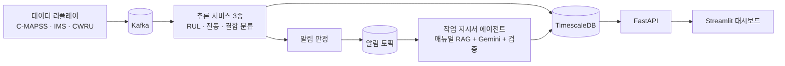

# 예지보전(PdM) 관제 시스템

설비 센서 데이터를 실시간으로 받아 **잔여수명(RUL) 예측, 베어링 이상 감지·결함 분류, 알림, 작업 지시서 생성**까지 한 화면에서 보여 주는 관제 시스템입니다.
Kafka · TimescaleDB · FastAPI · Streamlit으로 만들었고, 공개 벤치마크 데이터(NASA C-MAPSS, NASA IMS, CWRU)로 구현·검증했습니다.

> 🎬 시연 영상: https://github.com/user-attachments/assets/78d5a945-5487-49ff-be9d-e16bac1d663e 

> 📑 발표 자료: dosc/PdM_관제시스템_발표 자료.pptx

[대시보드] 

## 한눈에 보기

- **무엇을 하나요?** 엔진 100대의 센서(C-MAPSS), 베어링 4개의 진동(IMS), 베어링 결함 유형(CWRU)을 스트림으로 재생하며 상태를 계산합니다.
- **무엇을 보여 주나요?** 건전성 지수(Health Index, ( 0에 가까울 수록 고장 상태 / 100에 가까울 수록 정상 )), 잔여수명, 진동 스펙트럼, 베어링 결함 부위 추정, 주의·긴급 알림, AI가 정리한 작업 지시서를 보여 줍니다.
- **AI 에이전트는?** 알림이 생기면 매뉴얼에서 해당 절차를 찾아(RAG) Gemini가 상황을 요약하고, 규칙으로 검증한 뒤 작업 지시서를 만듭니다. 시한·절차 문장은 매뉴얼 원문만 씁니다.

## 어떻게 동작하나요?



1. 센서 데이터를 **Kafka**로 한 건씩 흘려 보냅니다(실제 공장 대신 공개 데이터를 재생).
2. 서비스 3개가 같은 전처리로 계산합니다. **RUL**(1D-CNN + Bi-LSTM), **진동 이상 점수**(Autoencoder), **결함 분류**(Random Forest).
3. 결과를 **TimescaleDB**에 저장하고, Health Index 기준을 넘으면 **알림**을 기록합니다.
4. 알림마다 **에이전트**가 작업 지시서를 만듭니다.
5. **FastAPI**가 데이터를 내어 주고, **Streamlit**이 화면으로 보여 줍니다.

## 구현 범위

| 기능 | 상태 |
|---|---|
| 스트리밍 수집 · 저장 · 알림 · 대시보드 (RUL · 진동 · 결함 분류 · 알림 · 작업 지시서 · 시스템 탭) | ✅ |
| 잔여수명(RUL) 예측 (C-MAPSS) | ✅ |
| 베어링 이상 감지 · Health Index · 스펙트럼 (IMS) | ✅ |
| 베어링 결함 유형 분류 (CWRU, 서비스 연동) | ✅ |
| 의심 결함 판정 (규칙 기반, IMS) | ✅ (외륜만 실제 데이터로 확인) |
| 작업 지시서 에이전트 (매뉴얼 RAG + Gemini) | ✅ (LangGraph는 미사용) |
| 관리자 알림 채널(카카오톡·Slack), 결함 부위 2D 시각화·회전 정지 표시, Weibull 신뢰구간, 처리량·지연 측정, CMMS 연동 | ⬜ 향후 |

## 주요 결과

| 데이터셋 | 결과 |
|---|---|
| **C-MAPSS** · 잔여수명 | RMSE **12.98 ± 0.56** (5개 시드 평균), 기본 모델(Random Forest) 17.86 |
| **IMS** · 이상 감지 | 정상 구간 41시간만 학습해 **고장 약 74시간 전** 경고 (Autoencoder, 리드타임 73.8시간, 시간–HI Spearman −0.89) |
| **CWRU** · 결함 분류 | 0HP로 학습, 3HP로 테스트(827윈도우) 정확도 1.00 — 쉬운 벤치마크라 큰 의미는 두지 않음. 서비스에서는 파일별 최근 10개 윈도우 투표 |
| **스트리밍 검증** | 13,096건 전송 → 예측 10,196건 저장, 서버 경로 RMSE 12.51 (노트북 12.98과 같은 수준) |
| **서버 ↔ Colab 일치** | 진동 점수의 Health Index 오차 0.00001 이하, CWRU 분류 확률은 scikit-learn과 완전 일치 |
| **알림** | 엔진 100대 한 번 재생에 긴급 29건, 주의 60건 (단계가 올라갈 때만 기록) |


[IMS 건전성 지수] 
*IMS: 베어링 1이 고장 난 베어링. 약 89시간부터 건전성 지수가 떨어집니다.*

## 대시보드 구성

| 탭 | 내용 |
|---|---|
| RUL · Health Index 현황 | 엔진·베어링별 상태와 추이 |
| 알림 | 주의·긴급 알림, 확인 처리 |
| 작업 지시서 | 에이전트가 만든 지시서 |
| 진동 | HI 추이, 엔벨로프 스펙트럼, 스펙트로그램, 결함 주파수 표시선, 의심 결함 |
| CWRU 분류 | 파일별 결함 유형 분류 결과 |

데이터 끊김(회색) 표시, 수집 중 표시, 상태 필터·검색, 리플레이 시작·중지·초기화 버튼을 제공합니다. 대시보드는 FastAPI만 호출하며 DB에 직접 접속하지 않습니다.

## 실행 방법

필요한 것: Python 3.10+, Docker Desktop, (선택) Gemini API 키

```powershell
python -m venv venv
venv\Scripts\activate
pip install -r requirements.txt
pip install torch --index-url https://download.pytorch.org/whl/cpu    # RUL 모델 로딩용

docker compose up -d            # Kafka, TimescaleDB
uvicorn main:app                # API 서버 (--reload는 비권장)
streamlit run dashboard/app.py  # 새 터미널, http://localhost:8501
```

실행 전에 준비할 것:
1. `.env.example`을 `.env`로 복사하고 값을 채웁니다(데이터 폴더 경로, DB 정보, Gemini 키).
2. 학습된 모델 파일을 `ml/artifacts/`에 넣습니다. Colab 노트북이 만들어 줍니다.
   - `rul_cnn_bilstm_fd001.pt`, `rul_meta_fd001.json` (RUL)
   - `ims_ae.pt`, `ims_anomaly_meta.json` (진동)
   - `cwru_rf.npz` (결함 분류), `cwru_ref.npz` (CWRU 검증 스크립트용 참조 데이터)
3. 매뉴얼을 `agent/knowledge/pdm_manual.md`에 둡니다(작업 지시서 에이전트용).

대시보드 왼쪽에서 데이터(C-MAPSS / IMS / CWRU)를 고르고 **▶ 시작**을 누르면 재생이 시작됩니다. 다시 돌리기 전에는 **DB 초기화**를 먼저 실행하세요.
Gemini 키가 없어도 에이전트는 템플릿 지시서로 동작합니다.

## 폴더 구조

```
smart_Factory/
├── main.py            # FastAPI 서버 (서비스 시작·종료)
├── core/              # Kafka 리플레이, 추론 서비스(RUL·진동·CWRU), 알림 판정, 에이전트 서비스
├── agent/             # 매뉴얼 파서, 검색(RAG), Gemini 클라이언트, 검증, 작업 지시서 조립
├── ml/                # 모델 코드와 학습된 파일(artifacts/)
├── api/               # REST API
├── models/            # DB 접근 코드
├── dashboard/         # Streamlit 화면
├── notebooks/         # Colab 노트북 3개
├── docs/              # 발표 자료, 이미지
└── docker-compose.yml
```

노트북: `pdm_feature_extraction.ipynb`(특징 추출·CWRU 분류), `pdm_rul_model.ipynb`(RUL 학습), `pdm_ims_autoencoder.ipynb`(IMS 이상 감지).

## 기술 스택

- **언어·환경**: Python, VS Code, Google Colab
- **데이터·ML**: pandas, NumPy, SciPy, scikit-learn, XGBoost, PyTorch
- **스트리밍·저장**: Apache Kafka(KRaft), TimescaleDB, Docker
- **백엔드·화면**: FastAPI, aiokafka, asyncpg, Streamlit, Plotly
- **AI 에이전트**: Gemini API (생성 `gemini-3.5-flash-lite`, 임베딩 `gemini-embedding-001`)

## 한계와 향후 과제

**한계**
- IMS는 고장이 1건뿐이라 일반화를 주장할 수 없습니다.
- 의심 결함 판정의 내륜·볼은 합성 신호로만 시험했습니다(IMS에는 외륜 결함만 있음). 베어링 2·4의 외륜 판정은 같은 축의 신호 전달로 추정되며 확인하지 못했습니다.
- IMS의 마지막 2개 파일은 회전 정지로 추정되어 분석 대상에서 제외하고 해석합니다.
- IMS 이상 감지에서 고장 기록이 없는 베어링 2 ~ 4의 오탐률(HI 60 미만 비율)이 약 12 ~ 13%였습니다.
- CWRU 정확도 1.00은 쉬운 벤치마크의 결과입니다. 결함 크기 일반화(0.021인치로 학습 → 0.007인치로 테스트) 실험에서는 정확도가 0.33으로 무너졌습니다.
- Health Index가 두 종류(C-MAPSS는 예측 RUL 기반, IMS는 이상 점수 기반)라 서로 직접 비교할 수 없습니다.
- 잔여수명의 단위는 사이클이며(시간 환산은 화면용 가정값), 처리량·지연은 측정하지 않았습니다(리플레이로 구조와 정확성만 검증). 성능 수치(초당 N건 등)는 제시하지 않습니다.
- 에이전트의 매뉴얼은 데모용이며, 작업 지시서는 실제 정비 지침이 아닙니다.

**향후 과제**
- 관리자 알림 채널(카카오톡·Slack)
- 에이전트: LangGraph 연결, 질의응답
- 결함 부위 2D 시각화, 회전 정지 표시
- 처리량·지연 시간 측정
- FTF 판정, 다중 운전조건 데이터(FD002~FD004), 1D-CNN 원신호 분류
- 클라우드 모델에서 웨이트 모델로 변경(Gemini -> Qwen)
- 가상 센서 및 plc 적용된 시뮬레이션으로 데이터 수집 단계 교체

<details>
<summary><b>더 보기: 알림 규칙 · 에이전트 · API · 환경 변수 · 검증 스크립트 · 문제 해결</b></summary>

### 데이터 파이프라인 상세
| 항목 | 내용 |
|---|---|
| 리플레이 | C-MAPSS는 엔진 100대를 사이클 순서로 섞어, IMS는 1초 파형(20,480샘플)을 베어링 4개 메시지로, CWRU는 2048샘플 윈도우(50% 겹침)로 전송. 대시보드 버튼(API)으로만 시작 |
| Kafka 토픽 | `factory.cycle.raw` · `factory.vibration.raw` · `factory.cwru.raw` · `factory.alerts` (초기 가상 경로는 `factory.sensor.raw`) |
| 순서·크기 | 메시지 키는 설비 ID(엔진·베어링)라 같은 설비의 순서가 보장됨. IMS 약 150KB, CWRU 약 43KB로 기본 한도(1MB) 안 |
| 컨슈머 그룹 | `rul` · `vib` · `cwru` · `agent`. 모두 DB 저장 성공 뒤 오프셋 커밋(at-least-once) |
| 안정성 | 같은 알림의 작업 지시서는 중복 생성 안 함, 형식 오류 메시지는 건너뛰고 로그만 남김, 서비스 하나가 시작에 실패해도 서버는 계속 실행(에러는 `/` 응답에 표시), 오래 데이터가 없는 설비의 버퍼 정리 |
| 시간 기준 | IMS 원본은 2004년 시각이라 DB `time`은 수신 시각, 원래 경과 시간은 `elapsed_h`에 저장 |
| 외부 의존 | Gemini 실패 시 템플릿, 임베딩 실패 시 키워드 검색으로 대체 |

### 알림 규칙
Health Index(C-MAPSS는 예측 RUL ÷ 125 × 100)가 **60 미만이면 주의, 30 미만이면 긴급**입니다. 단계가 **올라가는 순간에만** 기록하고, 기준보다 5 이상 회복해야 단계가 내려갑니다(경계에서 알림이 반복되지 않도록). 진동 알림에는 의심 결함이 함께 기록됩니다.

### 에이전트 동작
1. 알림 수신 → DB의 최근 이력으로 상황 정리
2. 알림 종류·단계·의심 결함으로 매뉴얼의 절차(SOP)를 **규칙으로 선택**, 결함 유형이 모호하면 임베딩 유사도(numpy)로 근거 문단을 추가 검색
3. 긴급·진동 알림에만 Gemini 호출(분당 제한): 상황 요약과 우선 조치 선택
4. 검증: 조치 id, 수치, 금지 표현을 확인하고 어긋나면 템플릿으로 대체
5. 시한·SOP 코드·조치 문장·안전 절차는 항상 매뉴얼 원문을 코드가 채움

### API (서버 실행 후 `http://localhost:8000/docs`)
| 경로 | 설명 |
|---|---|
| `POST /api/v1/replay/start` · `stop` · `reset` | 재생 시작 · 중지 · 초기화 (`kind`: cycle / vibration / cwru) |
| `GET /api/v1/rul/latest` · `history/{id}` | 엔진별 최신 예측 · 이력 |
| `GET /api/v1/vib/latest` · `history/{n}` · `spectrum/{n}` | 베어링별 상태 · 이력 · 스펙트럼 |
| `GET /api/v1/cwru/files` · `latest` | CWRU 파일별 분류 결과 |
| `GET /api/v1/alerts` · `POST /api/v1/alerts/{id}/ack` | 알림 목록 · 확인 처리 |
| `GET /api/v1/agent/workorders` · `summary` | 작업 지시서 · 생성 현황 |

### 주요 환경 변수 (`.env`)
| 변수 | 설명 |
|---|---|
| `KAFKA_BOOTSTRAP_SERVERS` | Kafka 주소 (기본 `localhost:9092`) |
| `DB_HOST` `DB_PORT` `DB_USER` `DB_PASSWORD` `DB_NAME` | TimescaleDB 접속 정보 |
| `CMAPSS_DATA_DIR` `IMS_DATA_DIR` `CWRU_DATA_DIR` | 데이터 폴더 (리플레이용) |
| `ENABLE_VIRTUAL_DATA` | 초기 가상 센서 파이프라인 사용 여부 (데모 시 `false` 권장) |
| `ALERT_WARN_HI` `ALERT_CRIT_HI` | 알림 기준 (기본 60 · 30) |
| `GEMINI_API_KEY` `GEMINI_MODEL` `GEMINI_EMBED_MODEL` | 에이전트용 Gemini 설정 (키가 없으면 템플릿 사용) |
| `AGENT_USE_LLM` `GEMINI_MAX_RPM` | LLM 사용 여부, 분당 호출 제한 |

### 데이터 배치
원본 데이터는 저장소에 포함하지 않았습니다. 공식 출처에서 받아 아래처럼 두세요.
```
data/
├── cmapss/  train_FD001.txt  test_FD001.txt  RUL_FD001.txt
├── 2nd_test/        # 파일 984개
└── cwru/    97.mat 100.mat 105.mat 108.mat 118.mat 121.mat 130.mat 133.mat ...
```

### 주요 검증 스크립트
| 스크립트 | 확인하는 것 |
|---|---|
| `check_vib_parity.py` | 서버의 진동 점수가 Colab 결과와 일치하는지 |
| `check_cwru_parity.py` | 서버의 CWRU 분류가 Colab(scikit-learn)과 일치하는지 |
| `check_fault_rule.py` | IMS 전체에서 의심 결함 규칙이 어떻게 판정하는지 |
| `check_agent.py` | 매뉴얼 읽기, Gemini 연결, 샘플 작업 지시서 생성 |

### 문제 해결
- `pyarrow requires NumPy 2.0 or newer` 오류: `pip install "pyarrow<16"`
- 서버 안의 RUL 서비스가 켜져 있을 때는 단독 워커(`python -m core.inference_worker`)를 동시에 실행하지 마세요.
- 재생을 다시 돌리기 전에는 대시보드의 **DB 초기화**를 먼저 실행하세요(데이터가 중복됩니다).
- 에이전트는 서버가 켜져 있는 동안 새로 생긴 알림만 처리합니다.

</details>

## 데이터 셋 출처

- NASA Prognostics Data Repository: C-MAPSS Turbofan Engine Degradation, IMS Bearing Data Set (University of Cincinnati)
- CWRU Bearing Data Center, Case Western Reserve University
